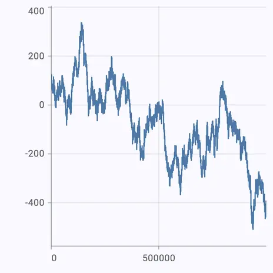
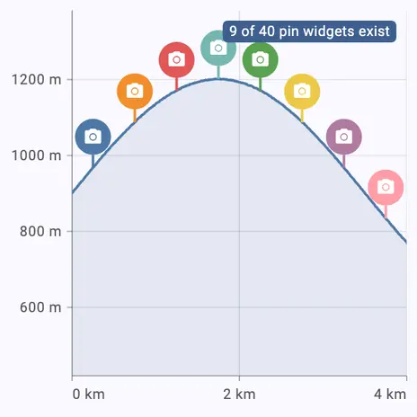
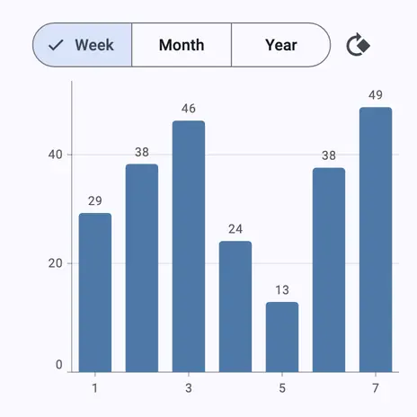
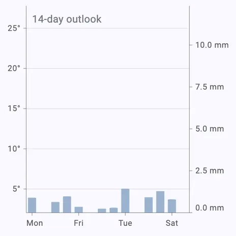
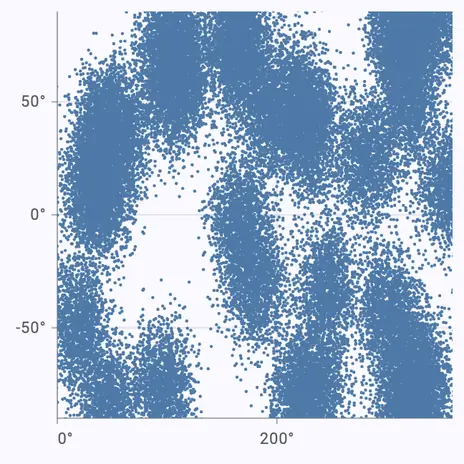
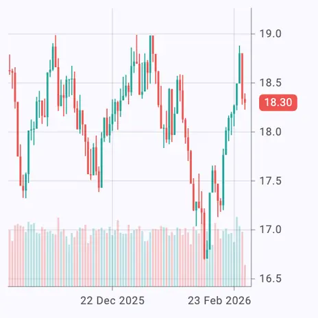
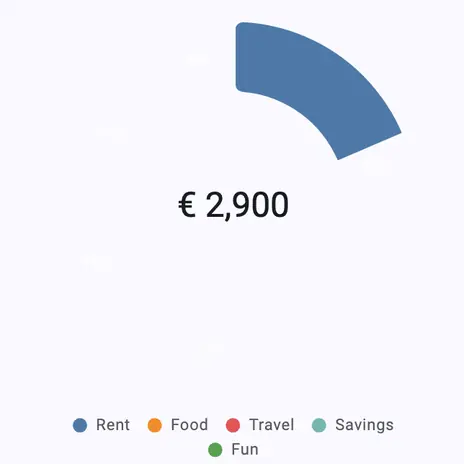
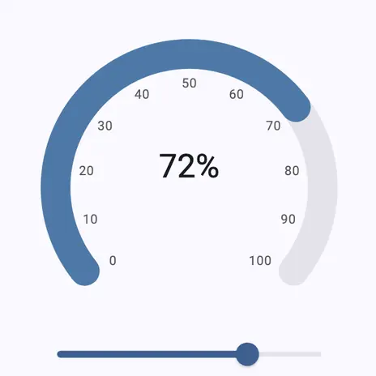
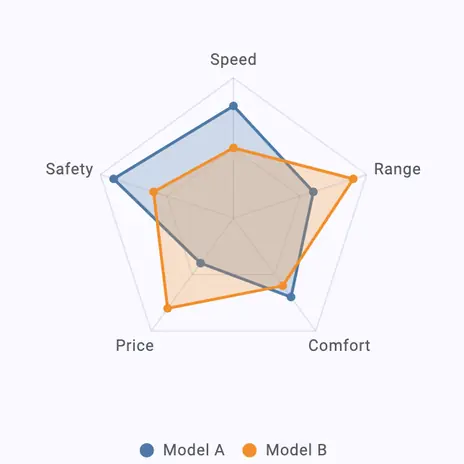

# plot_twist

[](https://pub.dev/packages/plot_twist)
[](https://pub.dev/packages/plot_twist/score)
[](https://github.com/glynskyi/plot_twist/actions/workflows/ci.yml)
[](https://github.com/glynskyi/plot_twist/blob/main/LICENSE)

Composable charts for Flutter. **[Try the live gallery](https://glynskyi.github.io/plot_twist/)**:
26 demos, each one small file.

<table>
<tr>
<td align="center"><a href="https://glynskyi.github.io/plot_twist/#/a10"></a><br><b>Line</b><br><sub>a million points · <a href="https://github.com/glynskyi/plot_twist/blob/main/example/lib/demos/a10_million_points.dart">code</a></sub></td>
<td align="center"><a href="https://glynskyi.github.io/plot_twist/#/a6"></a><br><b>Area</b><br><sub>with widget pins · <a href="https://github.com/glynskyi/plot_twist/blob/main/example/lib/demos/a06_photo_pins.dart">code</a></sub></td>
<td align="center"><a href="https://glynskyi.github.io/plot_twist/#/a19"></a><br><b>Bar</b><br><sub>morphs to new data · <a href="https://github.com/glynskyi/plot_twist/blob/main/example/lib/demos/a19_transitions.dart">code</a></sub></td>
</tr>
<tr>
<td align="center"><a href="https://glynskyi.github.io/plot_twist/#/a11"></a><br><b>Bars and a line</b><br><sub>on two Y axes · <a href="https://github.com/glynskyi/plot_twist/blob/main/example/lib/demos/a11_weather_combo.dart">code</a></sub></td>
<td align="center"><a href="https://glynskyi.github.io/plot_twist/#/a2"></a><br><b>Scatter</b><br><sub>50,000 points · <a href="https://github.com/glynskyi/plot_twist/blob/main/example/lib/demos/a02_star_map.dart">code</a></sub></td>
<td align="center"><a href="https://glynskyi.github.io/plot_twist/#/a26"></a><br><b>Candlestick</b><br><sub>with volume, live · <a href="https://github.com/glynskyi/plot_twist/blob/main/example/lib/demos/a26_candlesticks.dart">code</a></sub></td>
</tr>
<tr>
<td align="center"><a href="https://glynskyi.github.io/plot_twist/#/a21"></a><br><b>Pie and doughnut</b><br><sub>the legend pulls a slice out · <a href="https://github.com/glynskyi/plot_twist/blob/main/example/lib/demos/a21_polar.dart">code</a></sub></td>
<td align="center"><a href="https://glynskyi.github.io/plot_twist/#/a21"></a><br><b>Gauge</b><br><sub>follows a slider · <a href="https://github.com/glynskyi/plot_twist/blob/main/example/lib/demos/a21_polar.dart">code</a></sub></td>
<td align="center"><a href="https://glynskyi.github.io/plot_twist/#/a21"></a><br><b>Radar</b><br><sub>one tooltip for both · <a href="https://github.com/glynskyi/plot_twist/blob/main/example/lib/demos/a21_polar.dart">code</a></sub></td>
</tr>
</table>

Each picture opens its demo in the gallery. Other demos show
[live data](https://glynskyi.github.io/plot_twist/#/a15),
[linked charts](https://glynskyi.github.io/plot_twist/#/a16),
[a custom series](https://glynskyi.github.io/plot_twist/#/a8) and
[500 sparklines in a list](https://glynskyi.github.io/plot_twist/#/a24).

A plot_twist chart is a `Stack` in data space. Series, grids, axes, tooltips
and your own widgets are ordinary children that share one coordinate system.
Pan and zoom move them during layout and paint; no widget is rebuilt. When a
project needs something the package never planned for, you add a child
instead of forking the library.

- Pan and zoom in 2D: pinch, wheel, trackpad, axis drag and fling. Charts
  coexist with `ListView` and `PageView`.
- Any widget can be a tooltip, marker, axis label or overlay. Each one is
  placed by a data value, a fraction of the plot or a pixel offset, chosen
  per axis.
- One small painter contract covers custom series. A custom series gets
  automatic ranges, tooltips and crosshairs for free, the same way the
  built-in line, bar, scatter and candlestick series do.
- Line and area charts, vertical and horizontal bar charts, scatter plots
  and candlestick charts. Stacked bars and stacked areas; candles that are
  filled, hollow or OHLC bars. Data labels, a legend, reference lines and an
  appear animation are layers you add.
- Pie and doughnut (donut) charts, gauges and radar charts on a
  `PolarChart`, with the same legend, tooltip, data labels and animations.
- Linear, log, time and band scales, or your own transform. A time scale
  draws a time series with ticks that follow the calendar.
- Large datasets: a million-point line pans and zooms without a missed frame
  on a Mac (see [Performance](#performance)).
- Real-time data and lazily loaded history: a streaming chart follows its
  newest point, and older data loads as you scroll back. Linked charts share
  a viewport.
- No dependencies beyond Flutter's widgets layer. The package does not
  import Material or Cupertino.

The API is 0.x and can still change. 0.3.0 removed the parameter names that
0.2.0 had replaced (see the
[changelog](https://github.com/glynskyi/plot_twist/blob/main/CHANGELOG.md)).
To hear about new versions, watch the repository's releases on GitHub
(Watch → Custom → Releases).

## Quick start

```yaml
dependencies:
  plot_twist: ^0.3.0
```

```dart
import 'package:flutter/widgets.dart';
import 'package:plot_twist/plot_twist.dart';

class PriceChart extends StatelessWidget {
  const PriceChart({super.key, required this.prices});

  /// For example `ChartData.fromXY(times, values)`.
  final ChartData prices;

  @override
  Widget build(BuildContext context) {
    return Chart(
      x: const .time(),
      y: const .linear(range: .fitVisible()),
      left: const <Widget>[ChartAxis()],
      bottom: const <Widget>[ChartAxis()],
      children: <Widget>[
        const ChartGrid(),
        LineSeries(data: prices, label: 'Price'),
        const ChartPanZoom(),
        const ChartCrosshair(),
        const ChartTooltip(),
      ],
    );
  }
}
```

The Y axis follows whatever the X window shows. Drag to pan, pinch or scroll
to zoom, drag an axis to stretch it, and double-tap to reset. A chart with no
behaviors allocates no recognizers or tickers, so 500 sparklines in a list
stay cheap.

Coming from fl_chart? [doc/coming_from_fl_chart.md](doc/coming_from_fl_chart.md)
maps its concepts onto plot_twist and shows three charts written in both.
[doc/coming_from_charts_flutter.md](doc/coming_from_charts_flutter.md) does
the same for charts_flutter and its forks, such as community_charts_flutter.

## How it works

- **`ChartScale`** is configuration: a transform, a range policy (`fit`,
  `fitVisible`, `fixed` or `follow`), limits and ticks. Passing an equal
  scale on rebuild never resets the user's pan.
- **`ChartController`** holds the live state: one `ChartScaleController` per
  scale, plus the shared crosshair focus. Read the window with `chart.x.min`.
  Set it with `jumpTo`, animate it with `animateTo`, and listen like any
  `Listenable`. Share a scale controller between charts to link them.
- **`ChartView`** is an immutable snapshot built once per layout. It holds
  the plot size, every scale's window, `toPixel` and `toValue`, and the
  ticks. Children receive it through a channel that marks only the render
  objects that depend on it.
- **Side slots** (`left`, `top`, `right`, `bottom`) take any widget. They are
  measured first and settle in the same frame, so an axis sizes itself from
  its own labels.

[doc/architecture.md](doc/architecture.md) explains how this design works and
why it fits a chart.

## Extending a chart

| You need | Write | Example |
|---|---|---|
| A widget at a data point, a plot edge, or both | `ChartPositioned(x: .value(…), y: .fraction(…))` | markers, pills, handles |
| A position derived from live chart state | `ChartPositioned.resolve(position: (view) => …)` | the crossing dot below |
| Widgets built only for what is visible | `ChartLayoutBuilder<T>(selector: (view) => …, builder: …)` | lazy pins, per-bar semantics |
| A widget between two data values | `ChartPositioned.span(x1: …, x2: …)` | bands, placeholders, a navigator window |
| Custom drawing | `ChartPaint(painter: MyPainter())` with a `ChartPainter` | thresholds, shaded zones |
| A custom series | a `ChartSeriesPainter`: `paint`, `bounds`, `collectHits`, `valueAt` | a sleep hypnogram |
| A custom series around a circle | the same, with positions from `ChartPolar.resolve(view)` | a rose chart, a sunburst |
| A custom interaction | `ChartGestureDetector(gestures: …)` and the controller API | a long-press measure tool |
| A custom scale | subclass `ChartScale`: `transform`, `invert`, `defaultTicks` | a scale that skips weekends |
| Widget tick labels or axis markers | `ChartAxis(labelBuilder: …, markers: […])` | icons, chips, value pills |

The built-in series and behaviors are written against these same public
APIs, and a test makes sure they import nothing else.

### The crossing dot

This is the case that motivated the package: draw a dot where the line
crosses the Y axis, and keep it on the axis while the user scrolls.

```dart
final ChartController chart = ChartController();

Chart(
  controller: chart,
  y: const .linear(range: .fitVisible()),
  left: const <Widget>[ChartAxis()],
  children: <Widget>[
    LineSeries(id: 'temp', data: temperature),
    const ChartPanZoom(),
    ChartPositioned.resolve(
      // Runs in layout on every view change. The dot itself is never rebuilt.
      position: (ChartView view) {
        final double? y = chart.seriesById('temp')?.valueAt(view.x.min);
        return y == null ? null : view.toPixel(view.x.min, y);
      },
      overflow: .visible, // paint over the axis line
      child: const Dot(),
    ),
  ],
)
```

The gallery's A3 demo adds a value pill in the axis gutter and an arrow for
when the crossing leaves the visible range.

### A custom series

```dart
/// Lollipops: a stem from zero to each value, with a dot on top.
class LollipopPainter extends ChartSeriesPainter {
  const LollipopPainter(this.rows, this.color) : super(data: rows);

  final ChartData rows;
  final Color color;

  @override
  void paint(ChartPaintContext context) {
    final ChartView view = context.view;
    final Paint paint = Paint()
      ..color = color
      ..strokeWidth = 2;
    for (int i = 0; i < rows.length; i++) {
      final Offset top = view.toPixel(rows.x(i), rows.y(i));
      context.canvas
        ..drawLine(view.toPixel(rows.x(i), 0), top, paint)
        ..drawCircle(top, 4, paint);
    }
  }

  // Feeds automatic ranges.
  @override
  ChartDataBounds? bounds({ChartRange? xWindow, ChartRange? yWindow}) =>
      rows.isEmpty ? null : ChartDataBounds(x: rows.xExtent, y: rows.valueExtent()!.include(0));

  // Feeds tooltips and the crosshair.
  @override
  void collectHits(ChartHitQuery query, List<ChartHit> hits) {
    if (rows.isEmpty) return;
    final int i = rows.nearestIndex(query.view.x.toValue(query.position.dx));
    final Offset p = query.view.toPixel(rows.x(i), rows.y(i));
    final double distance = (p - query.position).distance;
    if (distance > query.maxDistance) return;
    hits.add(ChartHit(x: rows.x(i), y: rows.y(i), position: p, distance: distance, index: i));
  }

  @override
  bool shouldRepaint(LollipopPainter oldDelegate) =>
      oldDelegate.rows != rows || oldDelegate.color != color;
}

// In a chart:
ChartPaint(id: 'steps', label: 'Steps', color: color, painter: LollipopPainter(steps, color)),
```

The stems start at zero, so `bounds` adds zero to the Y range even though no
row holds it. With `collectHits` in place, `ChartTooltip` and `ChartCrosshair`
work on this series without knowing its type.

## Data

`ChartData` stores typed columns that can grow at both ends. Rows keep stable
ordinals when you prepend, so loading history never shifts the view. It keeps
a two-level min/max index, which is what makes Y auto-fit and million-row
lines cheap. When many rows share a pixel, line series reduce them to that
pixel column's extremes, so the line looks the same as the full-resolution
drawing.

```dart
final ChartData data = ChartData.from(
  readings,
  x: (r) => r.time.chartValue,
  y: (r) => r.celsius,
);
data.add(x, y); // live data: one notification, no widget rebuild
data.prependAll(xs, ys); // older history
data.removeFirst(100); // keep a window
```

## Bars, stacks and labels

Bars stand by default and lie with `direction: Axis.horizontal`. The data is
the same either way: the rows then run along the vertical scale and the
values along the horizontal one.

```dart
final List<ChartData> layers = ChartData.stacked(<ChartData>[online, retail]);

Chart(
  x: const LinearScale(range: FitDataRange(includeZero: true, padding: 0.1)),
  y: const BandScale(labels: <String>['Q1', 'Q2', 'Q3', 'Q4'], reversed: true),
  left: const <Widget>[ChartAxis()],
  top: const <Widget>[ChartLegend()],
  children: <Widget>[
    for (final (int i, String name) in <String>['Online', 'Retail'].indexed)
      BarSeries(
        data: layers[i],
        baseColumn: 1, // where the layer below ends
        direction: Axis.horizontal,
        label: name,
      ),
    // The size of every layer, written in its middle.
    ChartDataLabels(
      position: ChartDataLabelPosition.center,
      format: (ChartHit mark) => '${(mark.value - mark.base!).round()}',
    ),
    const ChartCrosshair(mode: ChartHitMode.nearestY), // picks a row
    const ChartTooltip(),
  ],
)
```

- A series without a `color` takes the next colour of the theme's palette.
- `ChartData.stacked` returns a store per layer with its top and its base.
  A `LineSeries` takes the same `baseColumn`, which makes a stacked area.
- `ChartLegend` lists the series that have a `label`. It reports taps and
  leaves it to your state which series is `visible`.
- `ChartDataLabels` labels every series, also one of your own. Above 250
  visible points it draws none.
- Around a series or a whole chart, `ChartAppear` grows the series in when
  they are first shown, under axes that stand still.
- `ChartReferenceLine.y(value)` draws a threshold or a target, with an
  optional label.

## Pie, gauge and radar

A `PolarChart` is a chart on a circle: its angle scale runs around the centre
and its radius scale from the centre outwards. The rest is as above. The
children are layers, and the legend, the tooltip, the data labels and the
animations are the same widgets.

```dart
// A doughnut with a total in its hole.
PolarChart(
  innerRadius: 0.6,
  bottom: const <Widget>[ChartLegend()],
  children: <Widget>[
    PieSeries(data: spending, labels: const <String>['Rent', 'Food', 'Fun'], gap: 2),
    const ChartDataLabels(position: ChartDataLabelPosition.center),
    const Center(child: Text('2,150')),
    const ChartCrosshair.point(), // follows the slice under the pointer
    const ChartTooltip(),
  ],
)

// A gauge: 72 of 100 on three quarters of a circle.
PolarChart(
  angle: const LinearScale(range: FixedRange(0, 100)),
  startAngle: 0.75 * math.pi,
  sweepAngle: 1.5 * math.pi,
  innerRadius: 0.8,
  children: <Widget>[
    RadialBarSeries(data: load, track: true, cap: StrokeCap.round),
    const ChartPolarAxis.angle(inside: true),
  ],
)

// A radar chart: the categories around, the values outwards.
PolarChart(
  angle: const ChartScale.band(labels: <String>['Speed', 'Range', 'Comfort', 'Price']),
  radius: const LinearScale(range: FixedRange(0, 10)),
  margin: const EdgeInsets.all(28), // room for the labels
  children: <Widget>[
    const ChartPolarGrid(shape: ChartPolarGridShape.polygon),
    const ChartPolarAxis.angle(),
    RadarSeries(data: modelA, label: 'Model A'),
    RadarSeries(data: modelB, label: 'Model B'),
  ],
)
```

- Angles are in radians and follow `Canvas.drawArc`: zero points to three
  o'clock and positive angles turn clockwise. A chart starts at twelve
  o'clock unless `startAngle` says otherwise.
- The slices of a `PieSeries` fill the whole sweep. On an angle scale with a
  fixed range they fill their share of it. `innerRadius` is the hole of a
  doughnut, `offsetOf` pulls a slice out, and with `labels` the legend shows
  one item per slice.
- A `RadialBarSeries` draws one ring per row. Give each ring a series of its
  own to get rings in different colours with a legend.
- A chart that turns less than a whole circle is laid out so that the part
  that is drawn fills the plot: a half-circle gauge is as wide as its plot.
- `ChartNeedle(value: …)` is the pointer of a gauge, and
  `ChartPolarPositioned` places any widget by an angle and a radius.
- `ChartAppear` with `ChartAppearEffect.reveal` draws a pie in around its
  centre. `AnimatedChartData` moves slices, bars and corners to new values.
- The three series are painters on the public contract, like the Cartesian
  ones. In a painter of your own, `ChartPolar.resolve(view)` gives the
  centre, the radius and the pixel of every value.

## Candlesticks

`CandlestickSeries` reads four value columns of a `ChartData`: the open, high,
low and close.

```dart
class CandleChart extends StatelessWidget {
  const CandleChart({super.key, required this.candles});

  /// One row per candle, with four value columns: open, high, low, close.
  final ChartData candles;

  @override
  Widget build(BuildContext context) {
    return Chart(
      x: const .time(),
      y: const .linear(range: .fitVisible()),
      right: const <Widget>[ChartAxis()],
      bottom: const <Widget>[ChartAxis()],
      children: <Widget>[
        const ChartGrid(),
        CandlestickSeries(data: candles, label: 'ACME'),
        const ChartPanZoom(),
        const ChartCrosshair(),
        ChartTooltip(
          builder: (BuildContext context, List<ChartHit> hits) {
            final ChartCandle c = hits.first.datum! as ChartCandle;
            return Text('O ${c.open}  H ${c.high}  L ${c.low}  C ${c.close}');
          },
        ),
      ],
    );
  }
}
```

It is written on the same `ChartSeriesPainter` contract as a custom series, so
Y fits the lows and highs in view, the crosshair snaps to a candle, and every
hit carries the candle's four prices as a `ChartCandle`.

```dart
final ChartData candles = ChartData.from<Bar>(
  bars,
  x: (b) => b.time.chartValue,
  y: (b) => b.open,
  more: [(b) => b.high, (b) => b.low, (b) => b.close],
);
candles.setValue(candles.length - 1, price, column: 3); // the last candle is still trading
candles.addRow(time, <double>[open, high, low, close]); // the next candle opens
```

- A candle that closes at or above its open is drawn in `upColor`, any other
  in `downColor`. `style: CandleStyle.hollow` outlines the candles that close
  at or above their open, and `CandleStyle.ohlc` draws open-high-low-close
  bars.
- A body is `widthFactor` × `step` wide. `step` defaults to the smallest
  distance between the first rows, so a night or a weekend without rows does
  not widen the candles. On a time scale that gap stays empty. To close it,
  plot the candles against their row number and label the axis with dates, as
  the gallery's A26 demo does, or use a custom scale such as the one in A14
  that skips weekends.
- When there are more candles than pixels, each pixel column is drawn as one
  candle made of its rows: lowest low to highest high, coloured by the first
  open and the last close. A test checks this with 100,000 candles, and
  [Performance](#performance) has the frame times.

The gallery's A26 demo adds volume bars on a second Y scale, a last-price pill
on the axis and a last candle that trades live.

## Performance

These numbers come from `example/test_driver/perf_test.dart`, run in profile
mode on macOS on a MacBook Air with an Apple M4. The figures are the 90th
percentile of UI-thread frame time and raster time:

| Scenario | Frames | Build p90 | Raster p90 | Missed frames |
|---|---|---|---|---|
| A10: wheel-zooming a 1,000,000-point line in and out | 120 | 2.2 ms | 1.3 ms | 0 |
| A10: panning about 160,000 visible points | 260 | 2.2 ms | 1.5 ms | 0 |
| A15: live ECG, 250 samples/s, following | 349 | 0.8 ms | 1.3 ms | 0 |
| A26: wheel-zooming 5,000 live candles with volume out and in | 80 | 2.7 ms | 1.7 ms | 0 |
| 100,000 candles: wheel-zooming in and out | 120 | 1.9 ms | 1.3 ms | 0 |
| 100,000 candles: panning about 16,000 visible candles | 305 | 1.9 ms | 1.5 ms | 0 |

The chart of 100,000 candles is part of the driver, not a gallery demo. The
three candle rows come from a later run than the first three, and in that run
the app window could not be brought to the foreground. That run measured the
A10 wheel zoom at 2.7 ms and 1.7 ms instead of 2.2 ms and 1.3 ms, so compare
the candle rows with those figures.

No phone was measured, so mobile figures are unknown.

## Example gallery

`example/` contains one small demo per aspect that chart libraries are judged
on, and [runs in the browser](https://glynskyi.github.io/plot_twist/); every
demo has its own link, such as
[`#/a10`](https://glynskyi.github.io/plot_twist/#/a10). Each demo is a single
file that uses only the public API. Their sizes are
counted in non-blank, non-comment lines after `dart format` at 100 columns,
and a test fails if any demo goes over 120 lines.

| | Aspect | Lines | | Aspect | Lines |
|---|---|---|---|---|---|
| A1 | Viewport controller | 76 | A14 | Pluggable scales | 86 |
| A2 | 2D pan and zoom | 54 | A15 | Live data | 85 |
| A3 | Edge-crossing marker | 90 | A16 | Linked charts | 82 |
| A4 | Widgets as tooltips | 93 | A17 | Editable annotations | 106 |
| A5 | Infinite history | 86 | A18 | Accessibility | 95 |
| A6 | Lazy widget markers | 82 | A19 | Animated transitions | 78 |
| A7 | Widgets as axis labels | 82 | A20 | Legend outside the chart | 68 |
| A8 | Custom series | 99 | A21 | Pie, gauge and radar | 113 |
| A9 | Gestures that coexist | 113 | A22 | Data-driven styling | 86 |
| A10 | One million points | 66 | A23 | Navigator by composition | 90 |
| A11 | Mixed series, two Y axes | 87 | A24 | Many small charts | 65 |
| A12 | Crosshair as shared state | 94 | A25 | Export to PNG | 85 |
| A13 | Auto-fit Y | 61 | A26 | Candlesticks | 109 |

```sh
cd example
flutter run -d macos   # or -d chrome
```

[doc/aspects.md](doc/aspects.md) explains why each aspect matters, with the
problems app developers report, and shows how each one is met.

## Not included yet

- In a polar chart: pan and zoom, bars that stand around the circle (a rose
  chart), and leader lines from a pie to labels outside it.
- A Material theme adapter and a `Scrollbar` adapter.
- Financial indicators such as moving averages and bands. Compute them in the
  app and draw the result with the built-in series.
- Tick labels that follow a locale, and right-to-left layout.

Nothing has been measured or tried on a phone yet.

## License

MIT
