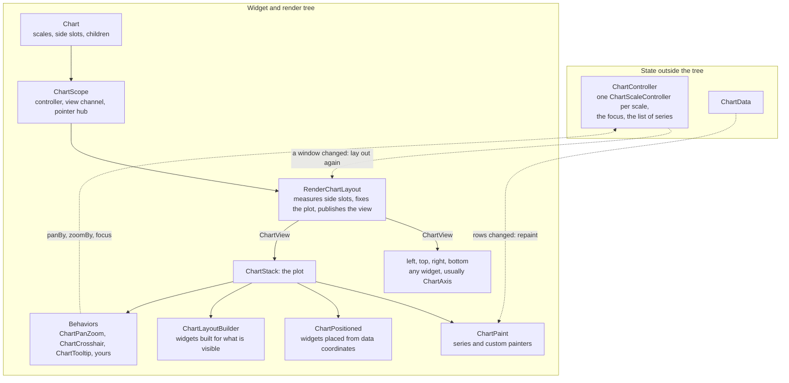
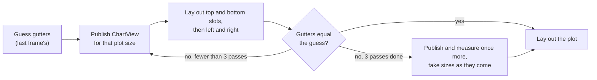
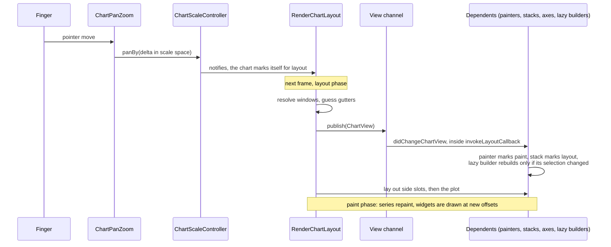

# Architecture

This document describes how plot_twist is built and why that design fits a
chart package.

## The goal

The package has to be composable and extensible. It does not have to contain
everything, but an app developer must be able to add what a project needs
without forking. The test case is a real one: draw a dot where the line
crosses the Y axis, and keep it on the axis while the user scrolls.

[aspects.md](aspects.md) lists the 26 things the architecture was checked
against.

## Why this design fits a chart

A chart is a `Stack` in data space. Series, widgets and behaviors are ordinary
children. The chart supplies one coordinate snapshot per layout and moves
things during layout and paint. It never rebuilds a widget because the user
panned.

That shape matches what a chart needs:

- **Coordinates are data, not pixels.** The visible window is a range per
  scale. Panning and zooming change that range, so they are linear on log and
  time scales, a second Y scale is one more range, and fitting Y to the
  visible data is a range policy (points 1 and 7).
- **The view stays put when data changes.** The window is stored in data
  values and rows keep their ordinals, so prepending history moves nothing on
  screen (points 1 and 8).
- **Panning is cheap.** A pan frame repaints and moves children. It builds no
  widget and lays out no widget in the plot (point 3 and
  [What a pan frame costs](#what-a-pan-frame-costs)).
- **Anything can be added.** Series, overlays and behaviors are children, so
  the list is open, and paint and hit-test order follow child order, as in a
  `Stack`. An overlay picks its anchor per dimension (a data value, a fraction
  of the plot or pixels from an edge), so it can follow the data along one
  axis and stay pinned along the other. The built-in series and behaviors use
  only the public API that app code uses.
- **Gestures coexist.** Behaviors listen at the chart's root, so a widget in
  the plot does not block them, and the pan recognizer claims only the drags
  it can use, so a parent list or page view still scrolls (points 5 and 6).

## How it works



Solid arrows go from parent to child. Dotted arrows are notifications, and
none of them rebuilds a widget.

### 1. State lives outside the tree, in data space

`ChartController` holds one `ChartScaleController` per scale. A scale
controller stores the visible window in scale space (after the scale's
transform), so panning and zooming are linear on log and time scales. It also
knows whether the window is automatic or was set by hand, the limits, and
whether a drag, fling or animation is running.

Scale controllers can be shared between chart controllers. That is all that
linking charts takes.

### 2. One immutable view per layout

`RenderChartLayout` reads the resolved windows, measures the side slots, fixes
the plot rectangle and builds a `ChartView`: the plot size and, per scale,
`toPixel`, `toValue` and the ticks. Automatic windows are resolved from the
bounds that the registered series report. `ChartController.view` keeps the
last view for event handlers.

### 3. A view channel instead of rebuilds

Render objects that depend on the view mix in `ChartViewDependent` and
register with the chart's `ChartViewChannel`, which they find through
`ChartScope`. When the view changes, `RenderChartLayout` tells each dependent
from inside `invokeLayoutCallback`, and each one marks what it needs:

- a painter calls `markNeedsPaint`;
- a `ChartStack` calls `markNeedsLayout` and moves its children;
- a `ChartLayoutBuilder` rebuilds only if its selected value changed.

Marking descendants dirty during layout is legal inside a layout callback and
takes effect in the same frame (`rendering/object.dart` in Flutter 3.50:
`_debugClosestMutationRoot` at lines 2317 to 2333, and `flushLayout` at 1160
to 1182. In 3.41.2, the oldest version the tests run on, the same rule is in
`_debugCanPerformMutations` at lines 2193 to 2207, and the `flushLayout` loop
is at 1159 to 1181). `LayoutBuilder` and `OverlayPortal` rely on the same
mechanism.

The consequences:

- Ordinary widgets in the plot are not laid out again during a pan.
- A chart-aware widget works under `Padding`, `Align` or `Stack`, because the
  view does not travel through constraints.
- Using one outside a chart throws an ordinary "No ChartScope found" error.

### 4. Side slots are measured, then committed

The side slots take any widget. An axis needs the view to know its ticks, and
the view needs the plot size, which depends on how thick the axes are. The
chart resolves this in a loop:

1. Publish a view for the current guess of the gutters. The first guess is
   the previous frame's gutters.
2. Lay out the top and bottom slots at the plot width, then the left and
   right slots at the remaining height.
3. If the gutters match the guess, stop. Otherwise repeat with the measured
   gutters.



The loop runs at most three times, and then settles on the last measurement.
While the gutters do not change, which is every frame of a steady pan, it runs
once. Laying a child out more than once in one `performLayout` is allowed
(`object.dart`, lines 2862 to 2870).

`ChartAxisExtent.auto` rounds the thickness up to a step, grows at once and
shrinks only while the chart is idle, so the plot does not jitter when a label
gains a digit. `ChartAxisExtent.shared(group)` gives the axes of every chart
in a `ChartGutterGroup` the same thickness, so linked charts line up.

### 5. A pointer hub at the root

`RenderChartLayout.handleEvent` forwards pointer events over the plot and the
gutters to handlers that behaviors register through `ChartScope`. A behavior
therefore acts like a gesture detector above the whole chart, and an opaque
widget in the plot does not block it:

- a marker's own `GestureDetector` wins a tap;
- a drag that starts on a marker still pans the chart;
- a widget that wants its drags to itself is wrapped in `ChartGestureShield`.

A chart with no behaviors is transparent to pointers and allocates no
recognizers.

### 6. A pan and zoom recognizer written for charts

`ChartPanZoomGestureRecognizer` extends `OneSequenceGestureRecognizer`.

- One sequence covers a one-finger pan and a pinch.
- It accepts a one-finger drag at the same slop as scrollables, and only along
  the dimensions it pans. A vertical drag on a chart that pans in X is left to
  a parent `ListView`.
- It claims the gesture when a second pointer goes down.
- It handles trackpad pan-zoom gestures.
- The wheel goes through `pointerSignalResolver`, and only when it would move
  the view, so a chart at its zoom limit lets the page scroll.
- A fling runs the platform's scroll physics in pixel space:
  `ScrollPhysics.createBallisticSimulation` with `FixedScrollMetrics` that
  describe the room left to pan.

### 7. Configuration and runtime state are separate

A `ChartScale` passed to `Chart` is configuration: transform, range policy,
limits and ticks. It is applied when it changes by `==`. A parent rebuild that
passes an equal scale does not reset the user's pan or the automatic-fit
state.

### 8. A data store built for charts

`ChartData` keeps X and one or more value columns in `Float64List`s that can
grow at both ends. Rows keep their ordinals when rows are prepended. A
two-level min/max index over blocks of rows answers extent queries for a
window quickly. `LineSeries` reduces dense rows per half-pixel column and
`CandlestickSeries` per pixel column. NaN marks a gap.

## Extension seams

These are listed from the easiest to the most powerful.

| Seam | What the app writes | Used for |
|---|---|---|
| `ChartPositioned` | a widget and an anchor per dimension, a resolver callback, or a span between values | markers, labels, placeholders, pinned overlays |
| `ChartLayoutBuilder<T>` | a selector `(view) => T` and a builder | widgets built for what is visible |
| `ChartPaint` and `ChartPainter` | `paint(context)` with a canvas and the view | bands, thresholds, any drawing |
| `ChartSeriesPainter` | `paint`, `bounds`, `collectHits`, `valueAt`, `visitMarks` | a series with automatic ranges, tooltips, data labels, a palette colour and a legend entry |
| `ChartPolar` in a `ChartSeriesPainter` | the same methods, with positions from `ChartPolar.resolve(view)` and hits that carry a `ChartSector` | a series around a circle, as the pie, radial bar and radar series are |
| `ChartScale` and `ChartTicks` | a transform and its inverse; a tick generator | log, time, category and custom scales |
| `ChartGestureDetector` and the controller API | recognizers and callbacks | custom interactions |
| `ChartAxis` and `ChartAxisMarker` | a label builder; widgets pinned to a value in the gutter | widget tick labels, value pills |
| `ChartViewDependent` | a render object | full control when a delegate is not enough |

The built-in series, grid and behaviors are written against the package's
public library only. A test checks that every file in `lib/src/series`,
`lib/src/layers` and `lib/src/behaviors` imports nothing but Dart, Flutter and
`plot_twist.dart`. Another checks that the package imports neither Material
nor Cupertino.

## What a pan frame costs

During a steady pan, a frame does this:

1. The scale controller changes and marks the chart for layout.
2. The chart publishes a new view. The gutter loop runs once.
3. Painters repaint. Positioned widgets get a new offset. Axis labels slide.
4. No widget is built, and widgets in the plot are not laid out again.



Tests assert this: 120 pan frames with zero builds and zero layouts of a
marker (`test/skeleton_test.dart`), and axis labels rebuilt only when the set
of ticks changes (`test/axis_test.dart`).

## Limits of the design

- Callbacks that run during layout (`ChartPositioned.resolve`, the selector of
  a `ChartLayoutBuilder`) run on every view change. They must be cheap and
  must not call `setState`.
- `ChartController.view` is the view of the last layout. An event handler that
  changes a scale and then reads the view in the same call sees the old one;
  `liveScaleView` gives the current mapping of one scale.
- The gutter loop is capped at three passes. Side widgets whose thickness
  keeps changing with the plot size settle on the third measurement.
- The chart itself is Cartesian. A polar chart is a projection made by its
  painters: `ChartPolar.resolve(view)` turns the angle scale and the radius
  scale into positions on a circle. The side slots, `ChartPositioned` anchors,
  pan and zoom and the lines of a crosshair do not follow it. So a polar
  chart is not panned or zoomed, and its series are hit by position
  (`ChartHitMode.nearest`) only.
- A scale's transform must be strictly increasing. A scale that folds or
  repeats values cannot be expressed.

## Where things are

```
lib/plot_twist.dart      the public library
lib/src/core/            ranges, scales, ticks, controllers, the view, the series contract, the polar frame
lib/src/data/            ChartData
lib/src/rendering/       the chart, stack and axis render objects, the view channel
lib/src/widgets/         Chart, PolarChart, ChartStack, ChartPositioned, ChartPaint, ChartAxis, themes
lib/src/interaction/     the pointer hub and the pan and zoom recognizer
lib/src/series/          line, bar, scatter, candlestick, pie, radial bar, radar  (public API only)
lib/src/layers/          grids, reference lines, data labels, the legend, the polar axis, the needle  (public API only)
lib/src/behaviors/       pan and zoom, crosshair, tooltip, loader, animated data, appear  (public API only)
```

The package is about 14,600 lines of Dart and has no dependencies besides
Flutter.
